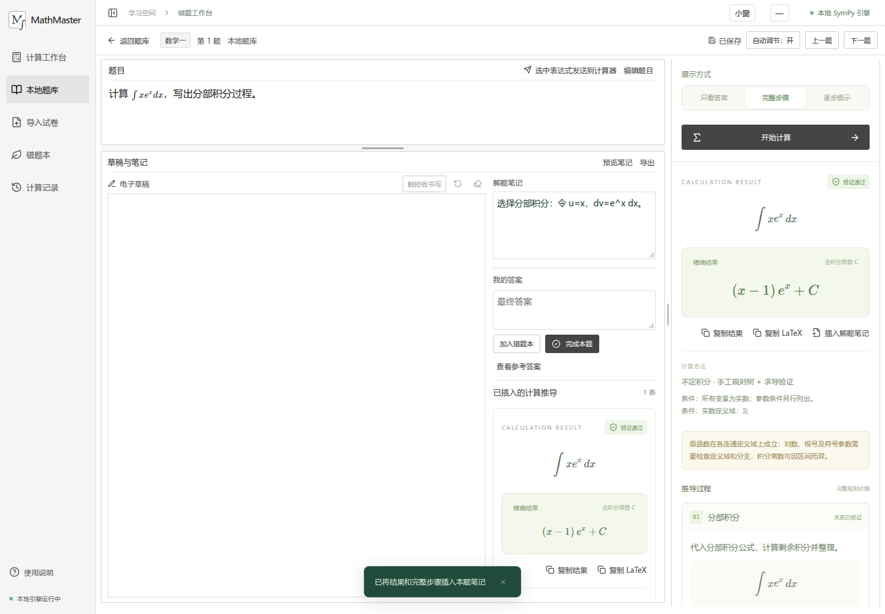

# MathMaster

可以离线使用的考研数学刷题与计算工作台。面向只有电脑、没有纸笔的练习场景，把题目、草稿、解题笔记和符号计算放在同一页面。

数学运算由本地 SymPy 完成，题库和记录保存在本机 SQLite。日常功能无需账号、付费 API 或 AI 服务。



## 已实现

- **积分与求导**：精确结果、中文规则树、独立验证，答案 / 完整步骤 / 逐步提示；支持定积分、常见反常积分、高阶导数和偏导。
- **矩阵与行列式**：表格输入、矩阵运算、秩、线性方程组、行最简形、增广矩阵求逆；展示可重放的初等行变换，与 SymPy 交叉验证。
- **本地题库**：数学一 / 二 / 三；导入 PDF、扫描 PDF、DOCX，保留原文件和可用截图，人工校对、拆分、合并及裁切。
- **做题工作台**：题目与草稿动态分配空间，可以拖动调整；计算器可收起、全屏或浮动，结果与完整步骤可插入笔记。
- **记录与备份**：自动保存答案、笔记、笔画、计算历史；继续作答、错题本、Markdown 导出与完整本地备份。
- **Windows 触控板书写**：读取兼容 Precision Touchpad 的原始坐标，用外接鼠标定位和收笔；书写区大小可调，独立窗口可缩小、还原和最小化。

## 快速开始

需要 **Python 3.11+**（建议 3.13）与 **Node.js 22.12+**。首次安装依赖需要联网，准备完成后可离线使用。

普通用户可以从 [Releases](https://github.com/dohomeworkbyzzy/MathMaster/releases) 下载含已构建前端的 `MathMaster-0.1.0-local.zip`；仅需 Python，无需 Node.js。

### Windows

1. 安装 [Python](https://www.python.org/downloads/) 并勾选 **Add Python to PATH**，安装 [Node.js LTS](https://nodejs.org/)。
2. 下载仓库 ZIP 并完整解压，或者克隆源码。
3. 双击根目录 **start.bat**，等待首次安装和构建完成。
4. 自动打开独立窗口，地址为 **http://127.0.0.1:8765**。

含 `dist` 的预构建 ZIP 不需要首次构建前端，因此不需要 Node.js；Python 和首次依赖安装仍然需要。启动控制台需要保持开启，关闭控制台或 Ctrl+C 会停止服务。

### Linux / WSL

```bash
bash start.sh
```

需要本系统的 Python、Node.js 和 venv 支持。Windows 与 WSL 使用独立虚拟环境，不要共用两个系统安装的 `node_modules`。

### 第一次使用

在计算工作台输入 `x*exp(x)`，查看分部积分步骤；在题库新建一道题，开始练习，写笔记或画草稿，再把计算步骤插入笔记。重新打开题目即可继续作答。

新安装的题库为空。本仓库不上传作者的个人题库、作答记录或第三方真题。可以导入自己的试卷，可选公开真题导入脚本的用法见操作手册。

## 文档

- [使用手册](docs/使用手册.md)：安装、公式输入、试卷导入、校对、做题、触控板、备份、常见问题。
- [技术说明](docs/技术说明.md)：技术栈、架构、步骤 JSON、API、解析限制、进程隔离及开发方式。
- [第三方许可](docs/第三方许可.md)：依赖与资料来源说明。
- [数学工作台实现说明](docs/数学工作台实现与验收说明.md)：数学规则适配、验证及早期验收记录。

## 功能边界

复杂积分可能只有答案而没有完整推导，界面会明确提示。发散、无法验证和符号参数条件也会显示，不编造步骤。

试卷自动拆题是候选结果，需要人工校对。扫描件 OCR 需要本地 Tesseract；DOCX 保留原版式截图需要 LibreOffice，否则仅提取可识别的内容。OCR 公式送入计算器前必须确认。

原始触控板书写仅支持 Windows 上可读取的 Precision Touchpad，建议使用外接鼠标。不同设备需要实际试写确认，普通鼠标画布可以直接使用。笔迹暂不自动识别成公式，隐函数求导、自动批改和排行榜尚未实现。

## 数据与开发

个人数据默认位于 `data/mathmaster.db` 与 `data/uploads/`。更新前在应用中下载完整备份；恢复步骤见使用手册。服务默认只监听本机，是单人本地工具。

```bash
python3 -m venv .venv
.venv/bin/python -m pip install -r requirements.lock -r requirements-dev.txt
npm ci
npm run build
.venv/bin/python -m uvicorn backend.app:app --host 127.0.0.1 --port 8765
```

另一个终端执行 `npm run dev` 可使用前端开发服务。Windows 将 Python 路径替换为 `.venv-win\Scripts\python.exe`。

```bash
.venv/bin/python -m pytest -q
npx playwright install --with-deps chromium
npm run test:e2e
```

浏览器测试使用独立数据目录和 8767 端口；数学测试校验结果和步骤关系，浏览器测试覆盖离线计算、导入、笔记草稿与布局。触控板硬件验收需要在目标设备执行。

构建并打包可分享的源码和预构建前端：

```bash
npm run build
.venv/bin/python scripts/package_release.py
```

输出位于 `artifacts/`，不含个人数据、虚拟环境或 `node_modules`。

## 许可

项目采用 [AGPL-3.0-only](LICENSE)。PDF 处理使用 PyMuPDF 的开源许可路径；再分发修改版或提供网络服务时，请遵守适用的许可与源码提供要求。第三方试卷不因导入本项目而获得同样的开源许可。
