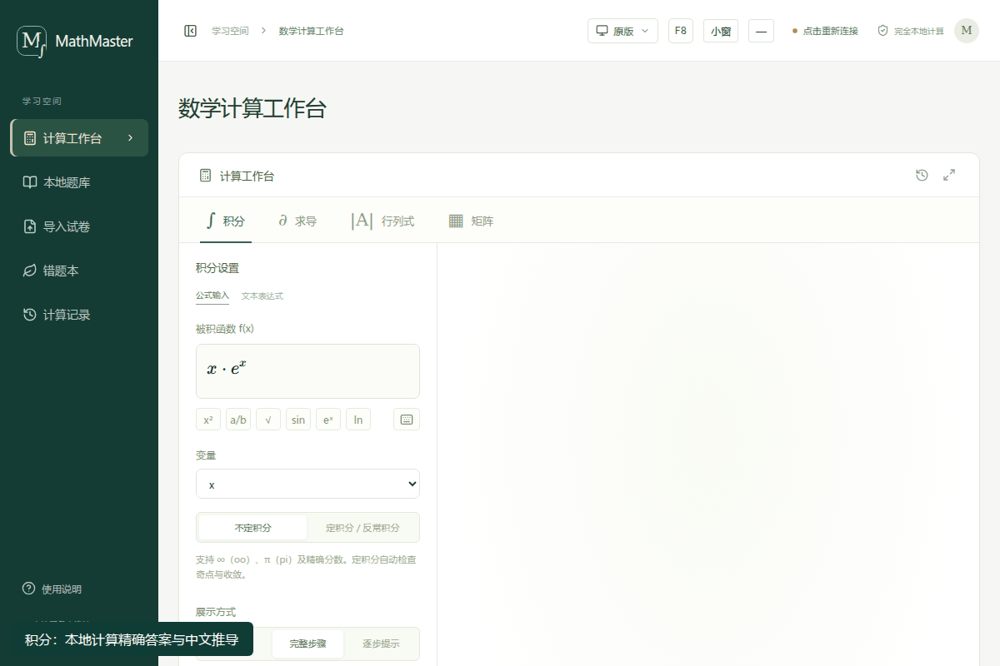
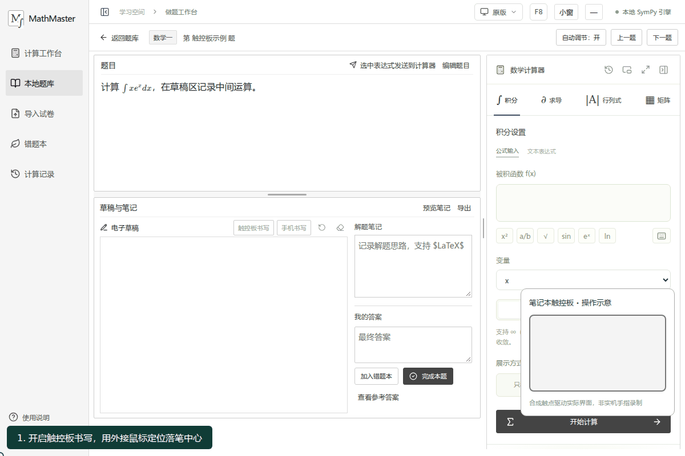

# Windows 安装版

普通使用者推荐下载 [GitHub Releases](https://github.com/dohomeworkbyzzy/MathMaster/releases) 中的 **MathMaster-Setup-0.2.0-x64.exe**。这是安装程序，不需要另装 Python、Node.js 或在首次启动时下载依赖。

## 安装和启动

1. 使用 Windows 10/11 x64，下载完整安装文件。
2. 双击安装；选择安装位置，保留「创建桌面快捷方式」即可。
3. 安装完成后启动，或者以后双击桌面 / 开始菜单的 MathMaster。
4. 程序在本机启动服务，并优先用 Edge/Chrome 独立窗口打开。默认端口为 8765；若被占用，会在后续几个本地端口中选择空闲端口，用户无需手工修改。

默认安装位置是 `%LOCALAPPDATA%\Programs\MathMaster`，不要求管理员权限。安装版仍以本地浏览器作为界面，不依赖远端网站或在线计算服务。

安装包尚未进行代码签名，Windows 可能提示未知发布者。请只从上述仓库下载，可用 PowerShell 核对同页的 `.exe.sha256`：

```powershell
Get-FileHash .\MathMaster-Setup-0.2.0-x64.exe -Algorithm SHA256
```

## 托盘和退出

窗口关闭后，后台服务仍运行。任务栏通知区域的 MathMaster 图标提供：

- **打开 MathMaster**：重新打开界面；双击图标也可打开。
- **打开数据文件夹**：定位题库和上传资料。
- **退出 MathMaster**：正常关闭服务与触控板读取进程。

也可使用开始菜单中的「退出 MathMaster」。重复打开桌面快捷方式会复用已有实例。

## 数据、升级和卸载

数据独立保存于：

```text
%LOCALAPPDATA%\MathMaster\
  data\mathmaster.db
  data\uploads\
  logs\
```

安装和程序文件不包含用户学习数据。升级前建议在应用中下载完整备份，然后在托盘退出，再运行新版安装程序。新版覆盖程序文件，保留上述数据目录。

卸载可使用 Windows「已安装的应用」或开始菜单的卸载入口。卸载会删除程序和快捷方式，**不会删除个人题库、草稿、笔记和原始试卷**。需要彻底清理个人数据时，请自行备份后删除数据目录。

从源码版迁移：先在旧程序导出完整备份，退出旧服务；启动安装版一次后在托盘退出，将备份中的 `mathmaster.db` 与 `uploads` 恢复到安装版 `data`。不要在服务运行时替换 SQLite 文件。旧目录中的 `data` 不会被安装程序移动或删除，也不会自动复制进新目录。

扫描 PDF 的本地 OCR 和 DOCX 原版式转换仍需要可选的 Tesseract / LibreOffice。未安装时程序会明确提示降级，普通符号运算和可读取的 PDF / DOCX 导入可以直接使用。

## GIF 演示





计算 GIF 使用实际界面和本地 SymPy。触控板 GIF 使用合成触点驱动实际前端，并验证草稿真实保存；画面已注明“操作示意，非实机手指录制”。它展示操作逻辑，不代表所有触控板已经过硬件验收。

## 开发者复现打包

必须在 Windows 原生环境构建 Windows EXE；WSL 的 Python 不能交叉编译。安装 Python 3.11+（当前本机包使用 3.14）、Node.js 22.12+、Git 和 [Inno Setup 7](https://jrsoftware.org/isdl.php)。

```powershell
py -3 -m venv .tools\build-win
.tools\build-win\Scripts\python.exe -m pip install -r requirements-windows-build.txt
npm ci
npm run build
.tools\build-win\Scripts\python.exe scripts\build_windows.py --iscc "C:\Program Files\Inno Setup 7\ISCC.exe"
```

脚本使用 [PyInstaller](https://pyinstaller.org/) 把 Python 和本地依赖打成目录式应用，再用 Inno Setup 制作单个安装 EXE。控制台隐藏，托盘由 [pystray](https://pystray.readthedocs.io/) 提供。程序通过固定 worker 参数启动积分、导入及触控板子进程，保留原有可终止的隔离边界。

`artifacts/` 输出安装 EXE、SHA256、预构建源码 ZIP 和冻结运行目录。安装包包含对应源码 ZIP、许可和可获取的依赖声明。正常运行不下载依赖。

打包验收：

```powershell
.tools\build-win\Scripts\python.exe scripts\check_windows_package.py artifacts\windows\MathMaster\MathMaster.exe
```

该脚本把被测试程序的 PATH 限制为 Windows 系统目录，检查真实冻结程序的数学结果、步骤验证、计算超时、PDF/DOCX 导入、笔记保存后重启、备份、托盘退出和重复启动。数据位于独立临时目录，不访问个人题库。实体手指书写还需在目标设备试用。

GitHub Actions 的 **Windows installer** 工作流可手动构建；无桌面的构建机只检查 headless 服务，不宣称完成托盘或实体触控板交互验收。
