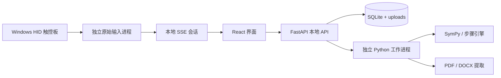

# MathMaster 技术说明

## 技术栈与职责

| 技术 | 用途 |
| --- | --- |
| React 19 + TypeScript | 题库、做题布局、计算器、步骤和草稿交互 |
| Vite 7 | 开发服务器、前端构建、静态资源本地打包 |
| MathLive | 数学公式输入、快捷公式和虚拟键盘 |
| KaTeX | LaTeX 结果与笔记公式展示 |
| Canvas / SVG | 电子草稿、触控板放大预览与收笔动画 |
| FastAPI + Pydantic + Uvicorn | 本地 HTTP API、请求校验和服务运行 |
| SymPy 1.14 | 符号计算与独立结果核验 |
| 自研积分/求导适配及矩阵步骤引擎 | 中文结构化推导、可重放行变换 |
| SQLite | 题库、作答、笔记、草稿和计算历史 |
| PyMuPDF + Pillow | PDF 文字提取、页面渲染、题图裁切 |
| python-docx | DOCX 段落、表格、内嵌图片与原始公式片段提取 |
| Tesseract / pytesseract（可选） | 扫描页文字 OCR，不能提供可信公式识别 |
| LibreOffice（可选） | DOCX 本地转 PDF，保留版式截图 |
| Python ctypes + Windows Raw Input / HID | 原始触控板坐标与外接鼠标事件读取 |
| Windows ClipCursor / SetWindowPos | 书写接触期间固定光标、独立窗口尺寸控制 |
| pytest + Playwright | 数学关系、API、保存及浏览器流程验证 |

核心运行不需要模型、付费 API 或远程计算服务。前端库和字体在构建时一起打包，不从 CDN 加载。首次准备依赖、开发安装和可选真题下载需要联网。

## 系统路径



服务默认只监听 `127.0.0.1:8765`，供单用户本机使用。应用检查 Host/Origin；该架构不应直接改成公网多用户服务。没有账号系统、跨用户权限或生产级部署沙箱。

## 数学引擎

积分使用 `integrate`、`manualintegrate` 和 `integral_steps`。步骤结构参考 [SymPy Gamma 积分](https://github.com/sympy/sympy_gamma/blob/master/app/logic/intsteps.py)及[求导](https://github.com/sympy/sympy_gamma/blob/master/app/logic/diffsteps.py)，为 SymPy 1.14 的 Rule/dataclass 重新适配，不复制旧 HTML 渲染器。

积分优先展示换元、分部、逐项、常数提出、部分分式和常见基本公式。未知规则可以保留验证后的答案，并明确 `steps_complete=false`。不定积分显示 `C`；定积分先检查定义域与奇点，分段检查单侧极限和收敛，不能无条件套用原函数两端相减。

求导步骤独立构造链式、乘积、商、幂和基本函数规则，再与 `sympy.diff` 核验。高阶或混合偏导逐次处理，未适配结构明确降级。

矩阵使用自研精确初等行变换引擎：主元选择、行交换、倍乘、倍加、RREF、秩、行列式、增广矩阵求逆及方程组。每步记录前后矩阵、系数与行列式乘数；用 SymPy 的 `det/rref/rank/inv/linsolve` 交叉验证。涉及符号主元时列出非零条件，不声称覆盖全部参数分支。

## 可保存的推导 JSON

公共结果字段包括：

```text
operation, input_latex, result_latex, exact_result, approximate_result,
method, assumptions, steps, verified, warnings,
steps_complete, history_id, created_at, question_id
```

每步至少包含 `step_id`、`rule`、`before_latex`、`after_latex`、`explanation_zh`、`children`，并可附验证证据、公式、行操作类型、行号、系数和行列式影响。

`verified` 表示在给定条件下的核验，`steps_complete` 表示推导覆盖情况；二者独立。后端返回结构化 JSON，前端负责中文和公式渲染，历史记录可以重新展示。

## 解析与计算隔离

`backend/parser.py` 用自研词法分析和 Pratt 文法构造 SymPy 对象，不对用户输入调用 Python `eval/exec`、`parse_expr` 或 `sympify(str)`。函数白名单、完整消费输入、括号检查及复杂度限制同时生效；受限 LaTeX 的未知片段会报错。

主要限制为 600 字符、160 词元、24 层嵌套、120 运算节点、8 阶导数和 8×8 矩阵。数学任务在独立进程中通过 JSON stdin/stdout 交换数据，默认 15 秒超时、最多两项并发，超时终止并等待回收。Linux 另设 CPU 与地址空间限制；Windows 不提供完整 OS 沙箱或 Job Object 内存配额。

## 试卷和保存

PDF 原文件、逐页截图和题图保存在 `data/uploads`。题号正则与本地 OCR 仅生成候选题，确认由用户完成。DOCX 转版式截图需要 LibreOffice，没有转换器时保留原文件与可提取内容。

SQLite 使用 WAL、外键和事务。作答保存携带 `expected_updated_at`，检测多窗口冲突；浏览器 localStorage 用于未同步草稿，按窗口和题目隔离。笔记的推导通过关联表引用完整计算记录；备份用 SQLite backup API，不能直接复制运行中的数据库作为可靠快照。

## 原始触控板与窗口

参考 MIT 项目 [finger-draw](https://github.com/arpruss/finger-draw) 和 [precision-trackpad-mapper](https://github.com/nameeenameee/precision-trackpad-mapper)，自行实现原始读取器。

`backend/touchpad_native.py` 注册 HID Digitizer / Touch Pad（Usage Page 0x0D、Usage 0x05），按设备报告解析 X/Y、Contact ID、Tip Switch、Confidence 和 Contact Count。触点切换和抬指分开笔画；多指或不可信接触不产生笔迹；优先按物理宽高比保持字形。

读取器不安装内核驱动、不修改注册表、不模拟触控板报告。书写接触期间通过 ClipCursor 固定光标；外接鼠标输入优先解除、抬指/失焦/退出也解除。关闭时先发 WM_CLOSE，异常退出还有桥接层的点状约束回收。仍需在不同硬件、显示缩放及同时移动外接鼠标场景下试用。

`backend/touchpad.py` 提供独立进程、随机所有者 token、单页面会话和有界队列。启动后 5 秒没有 SSE 连接便回收，一次会话最多 30 分钟。页面用归一化笔画映射到预览和草稿，预览尺寸与收笔尺寸独立。

Windows 启动脚本优先用 Edge/Chrome `--app` 打开独立窗口。`desktop_window.py` 仅调整当前前台的 MathMaster 浏览器窗口；使用 SetWindowPos/ShowWindow 实现小窗、还原、最小化。

Windows 安装版用 PyInstaller 冻结本地 Python 运行时，再用 Inno Setup 生成安装程序。`backend/runtime.py` 统一源码与冻结模式的工作进程命令；冻结模式通过固定参数进入数学、导入、触控板 worker，不调用外部 Python。启动器先设置用户数据目录，再加载 API，以命名 mutex 避免重复实例；托盘正常退出会关闭服务和读取进程。详见 [Windows 安装版](Windows安装版.md)。

## 项目目录

```text
backend/               API、解析器、数学与矩阵引擎、导入与 Windows 输入
web/                   React 界面、公式输入、步骤、草稿与布局
scripts/               启动准备、构建指纹、诊断、公开来源导入、运行包制作
packaging/windows/     冻结程序入口、PyInstaller spec、Inno Setup 安装脚本
tests/                 数学 / API / 浏览器测试，合成文档夹具
docs/                  使用手册、技术说明、第三方许可
.github/workflows/     干净环境构建与测试
data/                  启动时创建，个人记录，不提交
dist/                  本地构建产物，不提交源码仓库
```

## API 和开发

启动服务后打开 `http://127.0.0.1:8765/docs` 查看 OpenAPI 文档。

| 接口 | 用途 |
| --- | --- |
| `POST /api/math/integrate` | 积分 |
| `POST /api/math/differentiate` | 求导 |
| `POST /api/math/matrix` | 矩阵与行列式 |
| `GET /api/math/history` | 独立或逐题计算历史 |
| `POST /api/papers/import` | 试卷导入 |
| `GET/POST /api/questions` | 题库与新建 |
| `PUT /api/questions/{id}/attempt` | 作答、笔记和草稿自动保存 |
| `GET /api/backup` | 完整备份 |
| `POST /api/touchpad/start` | 开启原始书写会话 |
| `GET /api/touchpad/events` | 会话 SSE 输入流 |
| `POST /api/touchpad/stop` | 关闭读取进程并解除约束 |
| `POST /api/window` | compact / restore / minimize |

开发安装和测试命令见 README。浏览器测试使用隔离数据库和明确的事件夹具，不向个人题库写入示例；输入夹具不等于真实触控板验收。发布前应核对数学关系、保存恢复、错误降级与至少一次真实设备操作。
